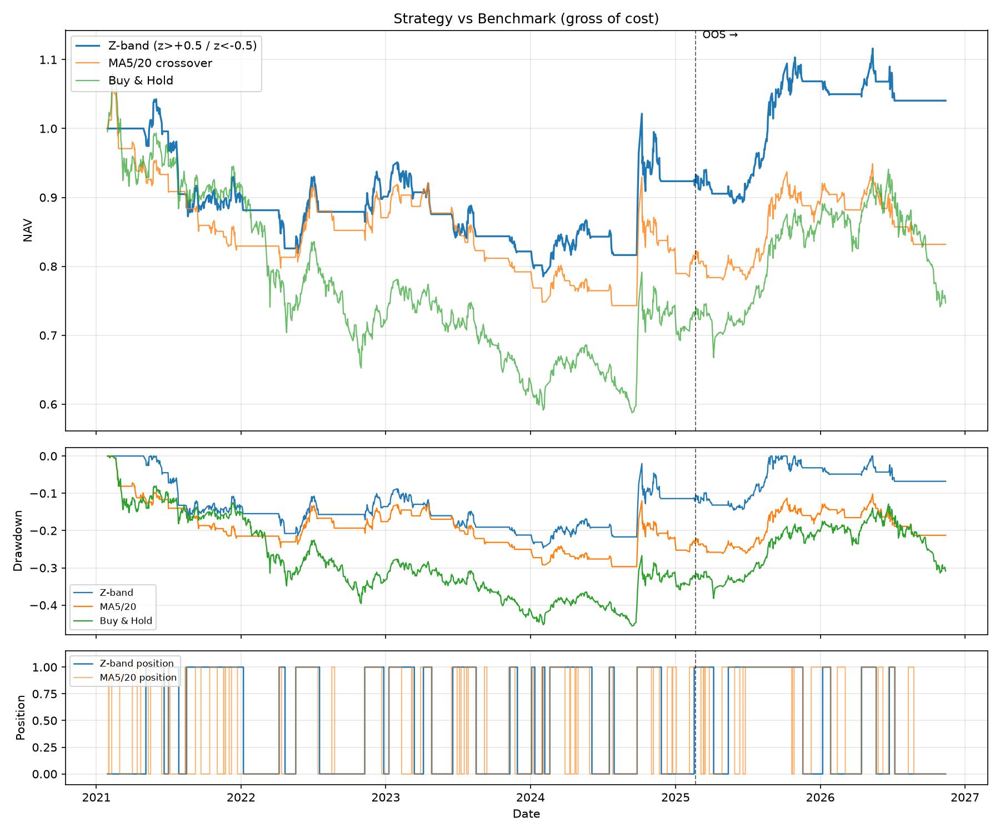

# 沪深300多源金融数据分析与均线趋势策略回测

一个端到端的量化研究小项目：**真实数据获取 → 多源时间对齐 → 清洗与特征工程 → 特征预测力检验 → 含成本回测与样本外验证**。

数据来自 [AKShare](https://akshare.akfamily.xyz/)（沪深300指数日线 + 中国制造业 PMI），覆盖 **2021-01-04 至今**。项目重点不只是"跑出一个策略"，更在于用 IC 检验、样本外切分与参数敏感性分析，诚实地回答：**这个信号到底有没有预测力？**

---

## 核心结论（TL;DR）

- 5 个候选特征（`ma_ratio` / `macd` / `vol20` / `vratio` / `pmi`）对次日收益的 IC 绝对值都不超过 **0.05**，**没有一个达到 5% 显著性**；扩展到 5/20/60 日周期（非重叠抽样）同样不显著。
- 因此，均线趋势策略的定位应是 **"下跌时空仓、控制回撤"**，而不是可交易的 alpha。
- 全样本（2021-01-29 → 2026-11-13，含单边 5bp 成本）：z-band 策略累计 **+2.0%**，同期买入持有 **-25.3%**；最大回撤 **-25.5% vs -45.6%**。
- 样本外（2025-02-21 起）：策略累计 **+12.4%**、夏普 **0.76**、最大回撤 **-6.9%**，基准分别为 +2.2%、0.16、-21.2%。
- 参数网格没有稳定占优的组合，结果对参数敏感——**不应把回测收益当作实盘预期**。



---

## 项目结构

```text
hs300-quant-analysis/
├── 01_fetch_data.py          # Step1 获取沪深300日线，计算日收益与净值
├── 02_align_pmi.py           # Step2 日频行情 × 月频 PMI 时间对齐
├── 03_clean_and_features.py  # Step3 清洗、特征工程、IC / 相关性 / 分组检验
├── 04_backtest.py            # Step4 策略回测、样本内外、成本与参数敏感性
├── import_data.py            # 可选：把特征表写入 MySQL
├── requirements.txt
├── .env.example              # 数据库连接串示例（复制为 .env 后使用）
├── data/                     # 中间数据与结果（脚本自动生成）
├── figures/                  # 图表（脚本自动生成）
│   └── hs300_dashboard.pbix  # Power BI 交互式仪表盘（手工搭建）
└── README.md
```

---

## 快速开始

### 1. 环境

需要 Python 3.10+（本项目在 3.14 下运行通过）。

```bash
python -m venv .venv

# Windows
.venv\Scripts\activate
# macOS / Linux
source .venv/bin/activate

pip install -r requirements.txt
```

### 2. 运行主流程

脚本使用**相对路径**（`data/`、`figures/`），请在项目根目录执行，顺序不能颠倒：

```bash
python 01_fetch_data.py          # -> data/hs300_daily.csv, figures/hs300_nav.png
python 02_align_pmi.py           # -> data/hs300_with_pmi.csv
python 03_clean_and_features.py  # -> data/hs300_features.csv, IC 表, 4 张图
python 04_backtest.py            # -> 回测明细/统计/参数网格, figures/hs300_backtest.png
```

### 3. 可选：写入 MySQL

```bash
cp .env.example .env    # 然后填写 DATABASE_URL
python import_data.py   # 将 data/hs300_features.csv 写入 hs300 表
```

`.env` 已被 `.gitignore` 忽略，不会提交到仓库。

---

## 方法与实现细节

### Step 1 — 数据获取（`01_fetch_data.py`）

- `ak.stock_zh_index_daily("sh000300")` 拉取沪深300**价格指数**日线；
- 截取 2021 年至今，按日期排序；
- 计算日收益 `ret = close.pct_change()` 与净值 `nav = cumprod(1+ret)`。

> 注：`sh000300` 是价格指数，不含分红；若使用全收益指数，长期收益会更高。

### Step 2 — 多源时间对齐（`02_align_pmi.py`）

- 从 `ak.macro_china_pmi()` 取制造业 PMI，把"2024年03月份"解析为**当月月末**；
- 用 `pd.merge_asof(direction="backward")` 将月频 PMI 对齐到每个交易日：任一交易日只能看到**已发布**的最新 PMI，避免未来函数；
- 中国官方制造业 PMI 在当月最后一天发布，因此按月末对齐与信息可得时点基本一致。

### Step 3 — 清洗、特征工程与预测力检验（`03_clean_and_features.py`）

**清洗**

- 对 OHLCV 做前向填充 `ffill`，避免滚动窗口整段作废；
- 用 **3σ** 标记收益异常日，但保留样本（多为真实极端行情，删除反而引入幸存者偏差）。

**特征（趋势 / 动量 / 波动 / 量能 / 宏观）**

| 特征 | 含义 |
| --- | --- |
| `ma5` / `ma20` | 5 / 20 日收盘均线（保留以兼容回测） |
| `ma_ratio` | `ma5 / ma20 - 1`，趋势强度的平稳化表达 |
| `dif` / `dea` / `macd` | MACD 指标，`macd = 2 × (dif - dea)` |
| `vol20` | 20 日收益标准差（波动率） |
| `vratio` | `volume / MA20(volume) - 1`，量能放大倍数 |
| `pmi` | 已对齐的制造业 PMI |

**冗余诊断**

- `ma5` 与 `ma20` 相关性约 0.99，属同一价格序列的两种平滑，故用 `ma_ratio` 代表趋势维度；
- `dif` 与 `ma_ratio` 相关性约 0.82 且 IC 更弱，剔除；
- 最终分析集：**`ma_ratio` / `macd` / `vol20` / `vratio` / `pmi`**，并用 VIF 复核（均低于 5）。

**预测力检验（而非同期相关）**

- **滞后 IC**：`feature(t)` vs `ret(t+1)`，同时给出 Pearson、Spearman、t 值；
- **滚动 IC / ICIR**（120 日窗口）：看预测力是否稳定，而非只在某段行情成立；
- **十分位分组**：先做 252 日滚动 z-score，再按分位统计平均未来收益，检验单调性与非线性。


### Step 4 — 回测（`04_backtest.py`）

- **信号**：对 `ma_ratio` 做 252 日滚动 z-score，加**滞回带**——`z > +0.5` 入场、`z < -0.5` 离场，中间区域维持原仓位，避免均线贴合时反复开平；
- **防前视**：信号在 t 日收盘生成，仓位 `shift(1)` 后从 t+1 日生效；
- **交易成本**：单边 5bp（佣金 + 冲击成本），调仓日按 `|Δ仓位| × 5bp` 计提，并另给零成本对照；
- **样本切分**：前 70% 为样本内（IS，2021-01-29 → 2025-02-20），后 30% 为样本外（OOS，2025-02-21 → 2026-11-13）；参数由经济含义预先固定，网格只用于展示 IS 敏感性，不拿 OOS 背书；
- **多周期复核**：对 1/5/20/60 日 horizon 用**非重叠抽样**重算 IC，避免重叠窗口高估 t 值。

---

## 回测结果

### 全样本（2021-01-29 → 2026-11-13，已扣 5bp 单边成本）

| 策略 | 累计收益 | 年化收益 | 年化波动 | 夏普 | 最大回撤 | 年化换手 | 年化成本 |
| --- | ---: | ---: | ---: | ---: | ---: | ---: | ---: |
| **z-band（默认 +0.5/-0.5）** | **+1.99%** | +0.35% | 12.30% | **0.09** | **-25.50%** | 7.19× | 0.36% |
| MA5/20 交叉 | -20.87% | -4.12% | 11.95% | -0.29 | -31.79% | 17.99× | 0.90% |
| 买入持有 | -25.35% | -5.12% | 18.06% | -0.20 | -45.60% | — | — |

### 样本内 / 样本外

| 区间 | 策略 | 累计收益 | 年化收益 | 夏普 | 最大回撤 |
| --- | --- | ---: | ---: | ---: | ---: |
| IS | z-band | -9.30% | -2.48% | -0.12 | -25.50% |
| IS | 买入持有 | -26.97% | -7.76% | -0.34 | -45.60% |
| OOS | z-band | **+12.39%** | **+7.24%** | **0.76** | **-6.92%** |
| OOS | 买入持有 | +2.17% | +1.30% | 0.16 | -21.23% |

### 分年度收益（不计交易成本）

| 年份 | z-band | MA5/20 | 买入持有 |
| --- | ---: | ---: | ---: |
| 2021 | -9.6% | -17.1% | -8.1% |
| 2022 | -0.3% | +5.0% | -21.6% |
| 2023 | -8.8% | -9.0% | -11.4% |
| 2024 | +12.4% | +2.7% | +14.7% |
| 2025 | +15.7% | +9.4% | +17.7% |
| 2026 至今 | -2.6% | -6.5% | -13.3% |

### 如何解读

- 策略在 2022、2024 等下跌/震荡年份通过空仓明显减少了亏损，代价是 2024、2025 的上涨段也错失了一部分；
- 全样本夏普仅 0.09、Calmar 仅 0.01，且 IC 不显著：**收益改善主要来自风险暴露的择时，而非稳定的预测能力**；
- 样本外表现较好，但只有一个切分、约 21 个月，样本量不足以证明可重复性。

---

## Power BI 仪表盘

`figures/hs300_dashboard.pbix` 是在脚本输出基础上手工搭建的交互式报表（单页，1920×1080）：

- **数据源**：`data/hs300_backtest.csv`（表名 `hs300_backtest`），即 Step 4 的逐日净值、信号与仓位明细；
- **组件**：日期切片器（默认 2021-01-29 → 2026-11-13）、策略收益与仓位指标卡、净值走势折线图；
- **打开方式**：用 [Power BI Desktop](https://powerbi.microsoft.com/desktop/) 打开该文件即可交互筛选；重新运行 `04_backtest.py` 后点击"刷新"即可同步最新回测结果。

> 注：`.pbix` 为二进制文件，Git 无法做行级 diff，每次保存都会整体产生新版本。

---

## 输出文件

### `data/`

| 文件 | 内容 |
| --- | --- |
| `hs300_daily.csv` | Step1 行情、日收益、净值 |
| `hs300_with_pmi.csv` | Step2 对齐 PMI 后的日频数据 |
| `hs300_features.csv` | Step3 特征表（不含 `fwd_ret`，避免误用导致前视） |
| `hs300_ic.csv` | 单特征滞后 IC、Spearman、t 值、ICIR |
| `hs300_ic_horizon.csv` | 1/5/20/60 日多周期 IC（非重叠） |
| `hs300_backtest_stats.csv` | 全样本 / IS / OOS × 各策略指标 |
| `hs300_backtest_yearly.csv` | 分年度收益 |
| `hs300_param_grid.csv` | 滞回带参数敏感性（仅 IS） |
| `hs300_backtest.csv` | 逐日净值、仓位、信号明细 |

### `figures/`

| 文件 | 内容 |
| --- | --- |
| `hs300_nav.png` | 沪深300净值曲线 |
| `hs300_corr.png` | 特征同期相关热力图（冗余检查） |
| `hs300_ic.png` | 滞后 IC 柱状图（Pearson vs Spearman） |
| `hs300_ic_rolling.png` | 120 日滚动 IC 小图 |
| `hs300_decile.png` | 前 3 特征十分位分组收益 |
| `hs300_backtest.png` | 净值 / 回撤 / 仓位三联图 |
| `hs300_dashboard.pbix` | Power BI 仪表盘（需 Power BI Desktop 打开） |

---

## 复现与工程细节

- **防前视偏差**：PMI 用 `merge_asof(backward)`；信号 `shift(1)` 后才持仓；`fwd_ret` 仅供分析、不写入特征文件；
- **平稳化**：价格水平类指标（均线偏离、MACD）在跨期比较前先做滚动 z-score；
- **稳健性**：Pearson 与 Spearman 对照，降低极端值影响；长周期 IC 用非重叠抽样校正 t 值；
- **成本意识**：同时输出毛收益、净收益、年化换手与成本拖累，避免把零成本回测当策略收益；
- **Windows 中文输出**：脚本将 stdout/stderr 切换为 UTF-8，避免 GBK 控制台乱码。

---

## 局限与声明

1. **样本有限**：单一指数、单一区间、一次 IS/OOS 切分，结论对市场状态敏感；
2. **无显著预测力**：所有特征在各 horizon 的 |t| 均小于 1.96，策略不应被解读为 alpha；
3. **参数敏感**：`enter/exit` 网格内没有稳定占优组合，默认参数按经济含义固定，但仍有选择自由度；
4. **执行假设简化**：以日收盘价成交、只做多、0/1 满仓，未建模滑点分布、涨跌停、停牌与资金容量；
5. **基准与成本**：使用价格指数（不含分红），5bp 单边成本为保守估计，实际因品种与规模而异。

> 本项目仅用于数据分析与方法练习，**不构成任何投资建议**。历史回测不代表未来表现。

---

## 依赖

| 包 | 用途 |
| --- | --- |
| `akshare` | 行情与宏观数据获取 |
| `pandas` / `numpy` | 数据处理与计算 |
| `matplotlib` / `seaborn` | 绘图 |
| `statsmodels` | VIF 共线性诊断、统计工具 |
| `scipy` | 科学计算依赖 |
| `sqlalchemy` / `pymysql` | 可选：写入 MySQL |
| `python-dotenv` | 读取 `.env` 数据库配置 |
