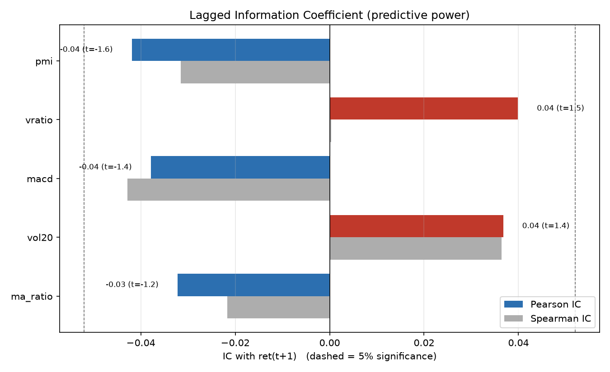
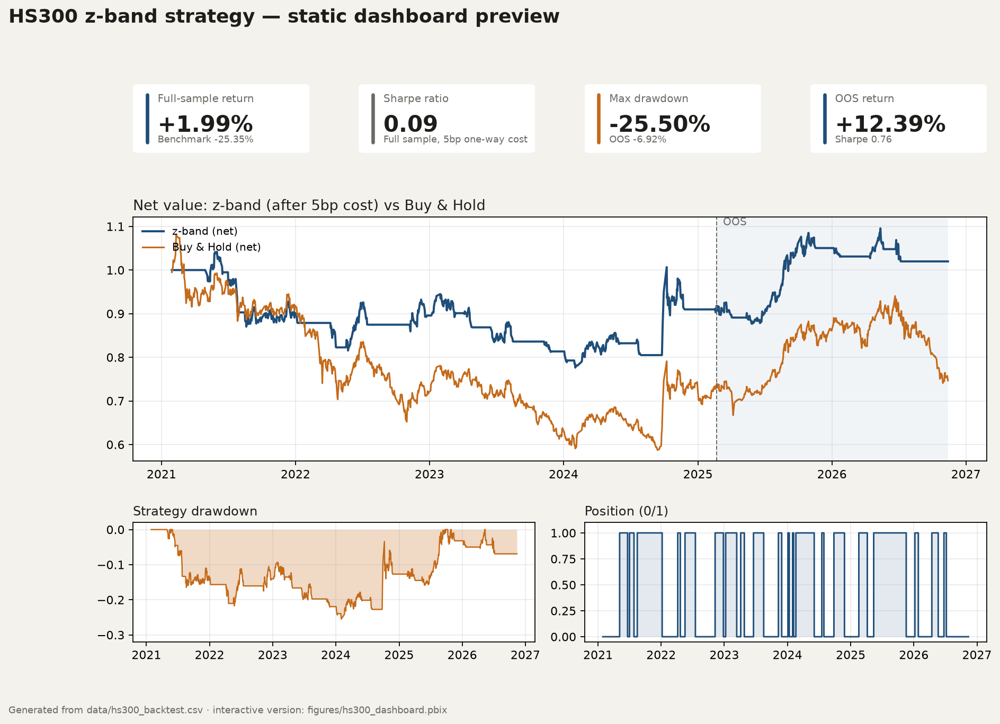

# 沪深300多源金融数据分析与均线趋势策略回测

一个端到端的量化研究小项目：**真实数据获取 → 多源时间对齐 → 清洗与特征工程 → 特征预测力检验 → 含成本回测与样本外验证 → MySQL 落库与数据质量校验**。

数据来自 [AKShare](https://akshare.akfamily.xyz/)（沪深300指数日线 + 中国制造业 PMI），覆盖 **2021-01-04 至 2026-11-13**。项目重点不只是“跑出一个策略”，更在于用 IC 检验、样本外切分与参数敏感性分析，诚实地回答：**这个信号到底有没有预测力？**

---

## 核心结论（TL;DR）

- 5 个候选特征（`ma_ratio` / `macd` / `vol20` / `vratio` / `pmi`）对次日收益的 IC 绝对值都不超过 **0.05**，**没有一个达到 5% 显著性**；扩展到 5/20/60 日周期（非重叠抽样）同样不显著。
- 因此，均线趋势策略的定位应是 **“下跌时空仓、控制回撤”**，而不是可交易的 alpha。
- 全样本（2021-01-29 → 2026-11-13，含单边 5bp 成本）：z-band 策略累计 **+2.0%**，同期买入持有 **-25.3%**；最大回撤 **-25.5% vs -45.6%**。
- 样本外（2025-02-21 起）：策略累计 **+12.4%**、夏普 **0.76**、最大回撤 **-6.9%**，基准分别为 +2.2%、0.16、-21.2%。
- 参数网格没有稳定占优的组合，结果对参数敏感——**不应把回测收益当作实盘预期**。


> 图内净值为**毛收益**（未扣成本）；下方统计表与 README 结论为扣除单边 5bp 后的**净收益**。静态看板预览见 [`figures/hs300_dashboard.png`](figures/hs300_dashboard.png)。

---

## 项目结构

```text
hs300-quant-analysis/
├── 01_fetch_data.py              # Step1 获取沪深300日线，计算日收益与净值
├── 02_align_pmi.py               # Step2 日频行情 × 月频 PMI 时间对齐
├── 03_clean_and_features.py      # Step3 清洗、特征工程、IC / 相关性 / 分组检验
├── 04_backtest.py                # Step4 策略回测、样本内外、成本与参数敏感性
├── import_data.py                # Step5（可选）MySQL 建表 + 质量校验 + 增量 upsert
├── run_all.py                    # 一键顺序运行 01–04
│
├── 05_mini_recon_gen.py          # mini: 造数（4 表 DDL + 价格 + 交易 + 公司行为 + 3 雷）
├── 06_anomaly_detection.py       # mini: Python 异常检测 3 档 → reports/*.csv
│
├── schema.sql                    # MySQL 表结构（主键、字段类型、注释）
├── requirements.txt              # 本机验证版本
├── requirements-dev.txt          # 开发/测试依赖（测试用标准库 unittest）
├── .env.example                  # 数据库连接串示例（复制为 .env 后使用）
├── data/                         # 中间数据与结果（脚本生成，仓库保留样例）
├── figures/                      # 图表与看板（脚本生成）
│   ├── hs300_dashboard.png       # 沪深300 看板静态预览
│   ├── hs300_dashboard.pbix      # 沪深300 Power BI 仪表盘
│   └── recon_dashboard.html      # mini 对账看板（浏览器直接打开）
├── sql/
│   ├── 01_ddl.sql                # mini 4 表 DDL
│   └── 02_reconciliation_queries.sql  # mini T+1 对账 + 收益率 + 视图
├── scripts/
│   ├── make_dashboard_preview.py
│   └── make_recon_dashboard.py   # mini HTML 看板生成
├── docs/
│   ├── design.md                 # 沪深300 关键设计取舍与开发时间线
│   ├── 口径说明文档.md           # mini 市值/盈亏/收益率 全口径定义
│   └── POWERBI_GUIDE.md          # mini Power BI 逐步骤 Copy-Paste 指南
├── reports/                      # mini 异常检测输出（脚本生成）
├── tests/
│   ├── test_alignment.py
│   ├── test_backtest_outputs.py
│   ├── test_data_quality.py
│   └── test_loader.py
├── CHANGELOG.md
├── LICENSE
└── README.md
```

---

## 快速开始

### 1. 环境

需要 Python 3.10+（本项目在 Python 3.14.7 下验证通过）。

```bash
python -m venv .venv

# Windows
.venv\Scripts\activate
# macOS / Linux
source .venv/bin/activate

pip install -r requirements.txt
```

### 2. 运行主流程

脚本使用**相对路径**（`data/`、`figures/`），请在项目根目录执行：

```bash
python run_all.py                # 一键按顺序运行 01–04
# 或逐步运行：
python 01_fetch_data.py          # -> data/hs300_daily.csv, figures/hs300_nav.png
python 02_align_pmi.py           # -> data/hs300_with_pmi.csv
python 03_clean_and_features.py  # -> data/hs300_features.csv, IC 表, 4 张图
python 04_backtest.py            # -> 回测明细/统计/参数网格, figures/hs300_backtest.png
```

### 3. 可选：写入 MySQL

```bash
cp .env.example .env    # 然后填写 DATABASE_URL
python import_data.py --dry-run   # 只做质量校验，不连接数据库
python import_data.py             # 建表 + 主键去重 + 增量 upsert
```

- 表结构见 [`schema.sql`](schema.sql)；
- 主键 `trade_date`，重复日期通过 `INSERT ... ON DUPLICATE KEY UPDATE` 覆盖；
- `.env` 已被 `.gitignore` 忽略，不会提交到仓库。

### 4. 运行测试

```bash
python -m unittest discover -s tests -v
```

测试使用标准库 `unittest`，不需要额外安装 pytest。

### 5. 生成看板静态预览

```bash
python scripts/make_dashboard_preview.py   # -> figures/hs300_dashboard.png
```

---

## 数据表结构（MySQL）

完整 DDL 见 [`schema.sql`](schema.sql)。核心设计：

```sql
CREATE TABLE IF NOT EXISTS hs300 (
    trade_date   DATE          NOT NULL COMMENT '交易日',
    open_price   DECIMAL(12,4) NULL     COMMENT '开盘价',
    high_price   DECIMAL(12,4) NULL     COMMENT '最高价',
    low_price    DECIMAL(12,4) NULL     COMMENT '最低价',
    close_price  DECIMAL(12,4) NOT NULL COMMENT '收盘价',
    volume       BIGINT        NULL     COMMENT '成交量',
    daily_return DECIMAL(12,8) NULL     COMMENT '日收益率',
    nav          DECIMAL(12,6) NULL     COMMENT '净值（起点 1.0）',
    pmi          DECIMAL(8,4)  NULL     COMMENT '制造业 PMI（月末发布，backward 对齐）',
    ma5          DECIMAL(12,4) NULL     COMMENT '5 日均线',
    ma20         DECIMAL(12,4) NULL     COMMENT '20 日均线',
    vol20        DECIMAL(12,8) NULL     COMMENT '20 日收益波动率',
    dif          DECIMAL(12,6) NULL     COMMENT 'MACD DIF',
    dea          DECIMAL(12,6) NULL     COMMENT 'MACD DEA',
    macd         DECIMAL(12,6) NULL     COMMENT 'MACD 柱 = 2 * (DIF - DEA)',
    ma_ratio     DECIMAL(12,8) NULL     COMMENT 'MA5 / MA20 - 1',
    vratio       DECIMAL(12,8) NULL     COMMENT 'volume / MA20(volume) - 1',
    updated_at   TIMESTAMP     NOT NULL DEFAULT CURRENT_TIMESTAMP
                                  ON UPDATE CURRENT_TIMESTAMP COMMENT '最后更新时间',
    PRIMARY KEY (trade_date)
) ENGINE=InnoDB DEFAULT CHARSET=utf8mb4 COMMENT='沪深300日频行情、特征与PMI对齐表';
```

### 数据字典（`data/hs300_features.csv`）

| 字段 | 类型 | 含义 | 来源 |
| --- | --- | --- | --- |
| `date` | DATE | 交易日 | AKShare |
| `open` / `high` / `low` / `close` | DECIMAL | 开高低收 | AKShare |
| `volume` | BIGINT | 成交量 | AKShare |
| `ret` | DECIMAL | 日收益率 `close.pct_change()` | 计算 |
| `nav` | DECIMAL | 净值，起点 1.0 | 计算 |
| `pmi` | DECIMAL | 制造业 PMI，按月末发布时点 backward 对齐 | AKShare |
| `ma5` / `ma20` | DECIMAL | 5 / 20 日均线 | 计算 |
| `vol20` | DECIMAL | 20 日收益标准差 | 计算 |
| `dif` / `dea` / `macd` | DECIMAL | MACD 指标，`macd = 2 × (dif - dea)` | 计算 |
| `ma_ratio` | DECIMAL | `ma5 / ma20 - 1`，趋势强度 | 计算 |
| `vratio` | DECIMAL | `volume / MA20(volume) - 1`，量能放大倍数 | 计算 |

> `fwd_ret`（未来收益）**只用于分析，不写入特征文件**，避免被误当作特征造成前视。
> 滚动特征前 19 个交易日为 NULL，入库时对应 MySQL `NULL`。

---

## 数据质量校验

`import_data.py` 在入库前执行以下检查，任一硬错误都会中止写入：

- 必需字段是否齐全（17 列）；
- `date` / `close` / `ret` / `pmi` 是否为空；
- `date` 是否重复（重复时按主键保留最后一条，并输出 warning）；
- 滚动特征是否在窗口之后仍为空；
- 日期范围与月度覆盖（当前：1,420 行、2021-01-04 至 2026-11-13、71 个自然月）；
- 输出统一报告，支持 `--dry-run` 无数据库运行。

```text
[validate] rows=1420, date_min=2021-01-04, date_max=2026-11-13, months=71, duplicate_dates=0
[validate] 滚动窗口内允许的空值：{'ma5': 4, 'ma20': 19, 'vol20': 19, 'ma_ratio': 19, 'vratio': 19}
[dry-run] 校验通过；未连接数据库。
```

---

## 方法与实现细节

### Step 1 — 数据获取（`01_fetch_data.py`）

- `ak.stock_zh_index_daily("sh000300")` 拉取沪深300**价格指数**日线；
- 截取 2021 年至今，按日期排序；
- 计算日收益 `ret = close.pct_change()` 与净值 `nav = cumprod(1+ret)`。

> 注：`sh000300` 是价格指数，不含分红；若使用全收益指数，长期收益会更高。

### Step 2 — 多源时间对齐（`02_align_pmi.py`）

- 从 `ak.macro_china_pmi()` 取制造业 PMI，把“2024年03月份”解析为**当月月末**；
- 用 `pd.merge_asof(direction="backward")` 将月频 PMI 对齐到每个交易日：任一交易日只能看到**已发布**的最新 PMI，避免未来函数；
- 中国官方制造业 PMI 在当月最后一天发布，因此按月末对齐与信息可得时点基本一致；
- `tests/test_alignment.py` 校验“PMI 在一个自然月内最多切换一次，且只在该月最后一个交易日切换”。

### Step 3 — 清洗、特征工程与预测力检验（`03_clean_and_features.py`）

**清洗**

- 对 OHLCV 做前向填充 `ffill`，避免滚动窗口整段作废；
- 用 **3σ** 标记收益异常日，但保留样本（多为真实极端行情，删除反而引入幸存者偏差）。

**特征（趋势 / 动量 / 波动 / 量能 / 宏观）**

| 特征 | 含义 |
| --- | --- |
| `ma5` / `ma20` | 5 / 20 日收盘均线（保留以兼容回测） |
| `ma_ratio` | `ma5 / ma20 - 1`，趋势强度的平稳化表达 |
| `dif` / `dea` / `macd` | MACD 指标，`macd = 2 × (dif - dea)` |
| `vol20` | 20 日收益标准差（波动率） |
| `vratio` | `volume / MA20(volume) - 1`，量能放大倍数 |
| `pmi` | 已对齐的制造业 PMI |

**冗余诊断**

- `ma5` 与 `ma20` 相关性约 0.99，属同一价格序列的两种平滑，故用 `ma_ratio` 代表趋势维度；
- `dif` 与 `ma_ratio` 相关性约 0.82 且 IC 更弱，剔除；
- 最终分析集：**`ma_ratio` / `macd` / `vol20` / `vratio` / `pmi`**，并用 VIF 复核（均低于 5）。

> 注意：VIF 在这里是**复核**，不是“逐个剔除直到 VIF<5”。机械按 VIF 删除可能删掉策略核心变量。

**预测力检验（而非同期相关）**

- **滞后 IC**：`feature(t)` vs `ret(t+1)`，同时给出 Pearson、Spearman、t 值；
- **滚动 IC / ICIR**（120 日窗口）：看预测力是否稳定，而非只在某段行情成立；
- **多周期复核**：对 1/5/20/60 日 horizon 用**非重叠抽样**重算 IC，避免重叠窗口高估 t 值；
- **十分位分组**：先做 252 日滚动 z-score，再按分位统计平均未来收益，检验单调性与非线性。



### Step 4 — 回测（`04_backtest.py`）

- **信号**：对 `ma_ratio` 做 252 日滚动 z-score，加**滞回带**——`z > +0.5` 入场、`z < -0.5` 离场，中间区域维持原仓位，避免均线贴合时反复开平；
- **防前视**：信号在 t 日收盘生成，仓位 `shift(1)` 后从 t+1 日生效；
- **交易成本**：单边 5bp（佣金 + 冲击成本），调仓日按 `|Δ仓位| × 5bp` 计提，并另给零成本对照；
- **样本切分**：前 70% 为样本内（IS，2021-01-29 → 2025-02-20），后 30% 为样本外（OOS，2025-02-21 → 2026-11-13）；参数由经济含义预先固定，网格只用于展示 IS 敏感性，不拿 OOS 背书；
- **多周期复核**：对 1/5/20/60 日 horizon 用**非重叠抽样**重算 IC，避免重叠窗口高估 t 值。

### Step 5 — MySQL 落库（可选，`import_data.py`）

- 读取 `data/hs300_features.csv`，校验 17 个字段；
- 按 `trade_date` 去重、排序，NaN 转 NULL；
- 执行 [`schema.sql`](schema.sql) 建表；
- 按主键 `trade_date` 执行 `INSERT ... ON DUPLICATE KEY UPDATE`，支持重复运行；
- 输出质量报告；`--dry-run` 可在没有 MySQL 的环境下跑通校验。

---

## 回测结果

### 全样本（2021-01-29 → 2026-11-13，已扣 5bp 单边成本）

| 策略 | 累计收益 | 年化收益 | 年化波动 | 夏普 | 最大回撤 | 年化换手 | 年化成本 |
| --- | ---: | ---: | ---: | ---: | ---: | ---: | ---: |
| **z-band（默认 +0.5/-0.5）** | **+1.99%** | +0.35% | 12.30% | **0.09** | **-25.50%** | 7.19× | 0.36% |
| MA5/20 交叉 | -20.87% | -4.12% | 11.95% | -0.29 | -31.79% | 17.99× | 0.90% |
| 买入持有 | -25.35% | -5.12% | 18.06% | -0.20 | -45.60% | — | — |

### 样本内 / 样本外

| 区间 | 策略 | 累计收益 | 年化收益 | 夏普 | 最大回撤 |
| --- | --- | ---: | ---: | ---: | ---: |
| IS | z-band | -9.30% | -2.48% | -0.12 | -25.50% |
| IS | 买入持有 | -26.97% | -7.76% | -0.34 | -45.60% |
| OOS | z-band | **+12.39%** | **+7.24%** | **0.76** | **-6.92%** |
| OOS | 买入持有 | +2.17% | +1.30% | 0.16 | -21.23% |

### 分年度收益（不计交易成本）

| 年份 | z-band | MA5/20 | 买入持有 |
| --- | ---: | ---: | ---: |
| 2021 | -9.6% | -17.1% | -8.1% |
| 2022 | -0.3% | +5.0% | -21.6% |
| 2023 | -8.8% | -9.0% | -11.4% |
| 2024 | +12.4% | +2.7% | +14.7% |
| 2025 | +15.7% | +9.4% | +17.7% |
| 2026 至今 | -2.6% | -6.5% | -13.3% |

### 如何解读

- 策略在 2022、2024 等下跌/震荡年份通过空仓明显减少了亏损，代价是 2024、2025 的上涨段也错失了一部分；
- 全样本夏普仅 0.09、Calmar 仅 0.01，且 IC 不显著：**收益改善主要来自风险暴露的择时，而非稳定的预测能力**；
- 样本外表现较好，但只有一个切分、约 21 个月，样本量不足以证明可重复性。

---

## Power BI 仪表盘



- `figures/hs300_dashboard.png`：由 `scripts/make_dashboard_preview.py` 从回测结果生成的**静态预览**（净值按扣 5bp 后的净收益重算），方便在 GitHub 直接查看；
- `figures/hs300_dashboard.pbix`：手工搭建的交互式报表（单页，1920×1080），数据源为 `data/hs300_backtest.csv`（表名 `hs300_backtest`）；
- **组件**：日期切片器（默认 2021-01-29 → 2026-11-13）、策略收益与仓位指标卡、净值走势折线图；
- **打开方式**：用 [Power BI Desktop](https://powerbi.microsoft.com/desktop/) 打开 `.pbix` 即可交互筛选；重新运行 `04_backtest.py` 后点击“刷新”即可同步最新回测结果。

> 注：`.pbix` 为二进制文件，Git 无法做行级 diff，每次保存都会整体产生新版本；静态预览不是 Power BI 截图，若你需要正式截图，可在 Power BI Desktop 中”导出 → 图像”替换 `hs300_dashboard.png`。

---

# 交易对账与收益率核算系统（mini 项目）

一个独立于沪深300回测的小型对账系统：**手写 DDL 建 4 表 → Python 模拟 3 个月交易与公司行为 → SQL T+1 对账 + 三套收益率口径 → Python 异常检测 → Power BI 日报与异常监控看板**。

模拟 5 只沪深300成分股 × 3 个账户，2026-08-01 至 2026-10-31（65 个交易日），并预埋 3 颗”对账雷”用于验证检测能力。

---

## 核心设计

| 维度 | 内容 |
|------|------|
| **数据模型** | 4 张表：`trade`（成交流水）、`position`（日频持仓）、`market_data`（行情）、`position_adjust`（非交易持仓变动：送转/拆股/配股/分红） |
| **对账公式** | 理论持仓 = `pre_qty + 当日净成交 + 非交易变动(qty_delta)`；差异 = 系统记录 − 理论 |
| **市值** | `qty × close_price` |
| **日盈亏** | `(今日市值 − 上日市值) − (买入 − 卖出 + 非交易资金流) + 现金分红` |
| **日收益率** | 三套口径：TWR（分母=上日市值）、Modified Dietz（分母=上日市值+0.5×净资金流）、简单（分母=上日市值+买入金额） |
| **累计 TWR** | `链表 Π(1+r) − 1`，用 `EXP(SUM(LN(1+r)))` 实现；新开仓/空仓日自动跳过 |
| **异常检测** | 对账差异（`diff ≠ 0`）+ 收益率 z-score 跳变（`> ±2.5`）+ 持仓为负（`qty < 0`） |

## 项目结构（mini 部分）

```text
├── 05_mini_recon_gen.py            # 造数：4 表 DDL + 几何布朗价格 + 交易模拟 + 公司行为 + 3 雷
├── 06_anomaly_detection.py          # Python 异常检测 3 档 → reports/*.csv
├── sql/
│   ├── 01_ddl.sql                   # 4 表完整 DDL（可在 DataGrip 直接执行）
│   └── 02_reconciliation_queries.sql # T+1 对账(A)、收益率(B/C)、浮动盈亏(D)、视图(E)、数据质量检查
├── docs/
│   ├── 口径说明文档.md              # 市值/盈亏/收益率/对账/异常检测 全口径定义
│   └── POWERBI_GUIDE.md            # Power BI 逐步骤 Copy-Paste 指南
├── scripts/
│   └── make_recon_dashboard.py     # 生成 HTML 交互看板（Plotly 折线图 + 点击下钻）
├── figures/
│   └── recon_dashboard.html        # 浏览器可打开的看板（无 Power BI 也能用）
└── reports/                        # 异常检测 CSV 输出
```

## 快速开始（mini 部分）

```bash
# 1. 造数据（依赖 .env 中的 DATABASE_URL 连 MySQL）
python 05_mini_recon_gen.py

# 2. 在 DataGrip 中执行 sql/02_reconciliation_queries.sql
#    全选 → Ctrl+Shift+F10，一次性建 4 个视图

# 3. Python 异常检测
python 06_anomaly_detection.py

# 4. 生成 HTML 看板（浏览器直接打开）
python scripts/make_recon_dashboard.py
# → 浏览器打开 figures/recon_dashboard.html
```

## 公司行为（5 笔，生成 13 条 position_adjust）

| 日期 | 标的 | 类型 | 对持仓的影响 |
|------|------|------|-------------|
| 2026-08-17 | 600519 贵州茅台 | 10送2 | 持仓 +20%，成本摊薄 |
| 2026-09-01 | 000858 五粮液 | 每股派 1.5 元 | 现金计入收益 |
| 2026-09-22 | 601318 中国平安 | 10配3 @30 元 | 持仓 +30%，缴款为外部资金流 |
| 2026-10-12 | 000333 美的集团 | 1拆2 | 持仓翻倍，成本减半 |
| 2026-10-22 | 600036 招商银行 | 10送1 | 持仓 +10% |

> 关键：所有公司行为在除权日做**前收盘价折算**（`ex_action_factor`），因此公司行为本身不会制造收益率跳变；`qty_delta` 参与对账，不会被误报成差异。

## 埋雷与检出

| 日期 | 账户 | 标的 | 偏差 | 检出 |
|------|------|------|------|------|
| 2026-09-15 | acc_001 | 600519 | 漏记 -100 股 | 对账差异 −100 × 2 天（新发 + 反转）+ 负持仓检出 + z-score −7.54 |
| 2026-10-20 | acc_002 | 000858 | 漏记 -200 股 | 对账差异 −200 × 2 天 + z-score −3.26 |
| 2026-10-28 | acc_003 | 601318 | 多记 +500 股 | 对账差异 +500 × 2 天 + z-score +5.73 |

最终检出 20 条异常：对账差异 6 + 收益率跳变 13 + 负持仓 1。

## 视图（Power BI / Python 直接消费）

| 视图 | 行数 | 用途 |
|------|------|------|
| `v_recon_diff` | 840 | 全量对账明细（含 diff / diff_type / diff_pattern / is_break） |
| `v_recon_breaks` | 6 | 只含差异行的异常清单 |
| `v_daily_return` | 840 | 每标的每日市值/盈亏/TWR/Dietz/简单收益率 |
| `v_account_daily_return` | 194 | 账户级汇总 + 链式累计 TWR / Dietz |

## 口径文档

完整公式、数值示例、边界假设见 [`docs/口径说明文档.md`](docs/口径说明文档.md)（8 章，已与数据库视图逐项核对）。

---

## 输出文件

### `data/`

| 文件 | 内容 |
| --- | --- |
| `hs300_daily.csv` | Step1 行情、日收益、净值 |
| `hs300_with_pmi.csv` | Step2 对齐 PMI 后的日频数据 |
| `hs300_features.csv` | Step3 特征表（不含 `fwd_ret`，避免误用导致前视） |
| `hs300_ic.csv` | 单特征滞后 IC、Spearman、t 值、ICIR |
| `hs300_ic_horizon.csv` | 1/5/20/60 日多周期 IC（非重叠） |
| `hs300_backtest_stats.csv` | 全样本 / IS / OOS × 各策略指标（净收益） |
| `hs300_backtest_yearly.csv` | 分年度收益 |
| `hs300_param_grid.csv` | 滞回带参数敏感性（仅 IS） |
| `hs300_backtest.csv` | 逐日净值、仓位、信号明细（`ret_band` / `nav_band` 为毛收益） |

### `figures/`

| 文件 | 内容 |
| --- | --- |
| `hs300_nav.png` | 沪深300净值曲线 |
| `hs300_corr.png` | 特征同期相关热力图（冗余检查） |
| `hs300_ic.png` | 滞后 IC 柱状图（Pearson vs Spearman） |
| `hs300_ic_rolling.png` | 120 日滚动 IC 小图 |
| `hs300_decile.png` | 前 3 特征十分位分组收益 |
| `hs300_backtest.png` | 净值 / 回撤 / 仓位三联图（毛收益） |
| `hs300_dashboard.png` | 看板静态预览（净收益） |
| `hs300_dashboard.pbix` | Power BI 仪表盘（需 Power BI Desktop 打开） |

---

## 复现与工程细节

- **防前视偏差**：PMI 用 `merge_asof(backward)`；信号 `shift(1)` 后才持仓；`fwd_ret` 仅供分析、不写入特征文件；
- **平稳化**：价格水平类指标（均线偏离、MACD）在跨期比较前先做滚动 z-score；
- **稳健性**：Pearson 与 Spearman 对照，降低极端值影响；长周期 IC 用非重叠抽样校正 t 值；
- **成本意识**：同时输出毛收益、净收益、年化换手与成本拖累，避免把零成本回测当策略收益；
- **数据质量**：入库前校验字段、主键、空值、日期范围与月度覆盖；支持 `--dry-run`；
- **可复现**：`run_all.py` 一键跑完 01–04；`requirements.txt` 锁定本机验证版本；
- **Windows 中文输出**：脚本将 stdout/stderr 切换为 UTF-8，避免 GBK 控制台乱码。

---

## 测试

```bash
python -m unittest discover -s tests -v
```

当前 23 个测试，覆盖：

- **数据质量**：1,420 行、日期范围、主键唯一、空值模式、PMI 覆盖；
- **时间对齐**：PMI 无缺失、与特征表一致、月度切换时点；
- **回测一致性**：仓位是信号滞后一日、仓位 0/1、净净值与统计表一致、样本外回撤；
- **加载器**：字段映射、重复日期去重、关键字段空值拦截、`--dry-run` 不依赖数据库。

---

## 局限与声明

1. **样本有限**：单一指数、单一区间、一次 IS/OOS 切分，结论对市场状态敏感；
2. **无显著预测力**：所有特征在各 horizon 的 |t| 均小于 1.96，策略不应被解读为 alpha；
3. **参数敏感**：`enter/exit` 网格内没有稳定占优组合，默认参数按经济含义固定，但仍有选择自由度；
4. **执行假设简化**：以日收盘价成交、只做多、0/1 满仓，未建模滑点分布、涨跌停、停牌与资金容量；
5. **基准与成本**：使用价格指数（不含分红），5bp 单边成本为保守估计，实际因品种与规模而异。

> 本项目仅用于数据分析与方法练习，**不构成任何投资建议**。历史回测不代表未来表现。

---

## 依赖

| 包 | 版本 | 用途 |
| --- | --- | --- |
| `akshare` | 1.20.37 | 行情与宏观数据获取 |
| `pandas` / `numpy` | 3.0.6 / 2.5.3 | 数据处理与计算 |
| `matplotlib` / `seaborn` | 3.11.2 / 0.13.2 | 绘图 |
| `statsmodels` | >=0.14.4 | VIF 共线性诊断、统计工具 |
| `scipy` | 1.18.1 | 科学计算依赖 |
| `SQLAlchemy` / `PyMySQL` | 2.1.8 / 1.2.4 | MySQL 落库 |
| `python-dotenv` | 1.2.4 | 读取 `.env` 数据库配置 |

---

## 开发记录

- 设计取舍与时间线：[`docs/design.md`](docs/design.md)
- 变更日志：[`CHANGELOG.md`](CHANGELOG.md)
- 许可证：[MIT](LICENSE)
